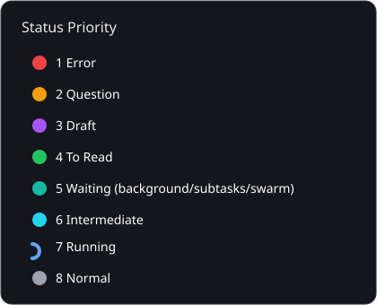
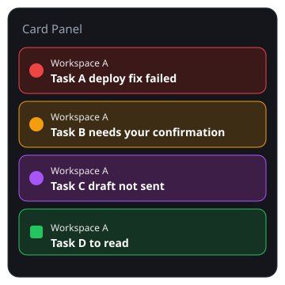

# dsh-dingo 2.4

**English** | [中文](README.zh.md)

**Ding + Go** — a DSH plugin for session cards, auto-naming, sounds, and deep links.

## 2.4.1 fixes (DSH 0.2.2)

- Auto-naming works again: `apiProxy` is gone in 0.2, so the button, `/dingo rename` and the
  `rename_current_session` tool now use `sessionController.rename` / `events`, with the legacy
  `apiProxy.sessions` path kept only as a fallback (`src/session-api.ts`). Host calls time out after 15s.
- Tones are no longer missed: the `speaking` window floor is 4s (the client polls once per second) and
  the client re-polls on `visibilitychange` / `focus` (background tabs get their timers throttled).
- Quiet hours actually replay: the engine now arms a timer at the `quietHours` end instant.
- System-notification deep links no longer hardcode port 3080; the host's own origin is used when unset.
- `webServer` is an optional dependency: hosts without a web carrier just skip the `/dingo` RPC.
- Cleanups: removed the never-effective `channelAuthority` config, debug logs and dead branches;
  `toneStyle` now drives non-current sessions; title-cache reads are negatively cached.

## Features

- 1:1 persistent session cards
- Multiple statuses with colors and priority ordering
- Compact summary pill + hover detail panel
- Cross-session draft detection
- Background job / subagent / swarm waiting state
- Current workspace label
- Background task count display
- Auto-naming (button / natural language / command)
- Sounds + system notifications + deep-link (kept from 1.x)

## Status Priority



| Priority | Status | Meaning | Color |
|---|---|---|---|
| 1 | Error | task failed / abnormal end | red |
| 2 | Question | needs your answer | orange |
| 3 | Draft | another session has unsent input | purple |
| 4 | To Read | completed and needs reading | green |
| 5 | Waiting | main done, background/subtasks/swarm still running | teal |
| 6 | Intermediate | running with partial output | cyan |
| 7 | Running | running | blue spinner |
| 8 | Normal | completed and seen | grey |

> Typing in the current session is a normal state and does not trigger the draft reminder; after switching away, the previous session's draft becomes a purple reminder again.
> Scope: the client can only read the *current* session's input snapshot (`sessions.binding(id)` is limited to retained sessions), so the purple state covers sessions opened in this tab that were left with a draft.

## Usage

> Position: DSH is a three-column layout — **left sidebar** (workspaces / session list, settings) | **center conversation column** | **right details column**.
> The summary bar sits at the **bottom of the left sidebar**, as the topmost row of the footer area: **above the footer action buttons** (e.g. the Cordis panel icon) and **above the Settings (gear) button**.

- At the bottom of the left sidebar you will see a **full-width status bar** (the summary pill) on **its own row**, above the footer action buttons (Cordis panel etc., which wrap to the next line) and above the Settings (gear) button:
  - red error dot + count / orange question dot + count / running spinner + count / intermediate / waiting / normal counts (icon sits tight against its number, units spaced apart);
  - when something needs attention the whole bar breathes and glows (error pulses fastest);
  - the right side shows "N active sessions".
  - **Empty state**: with no active sessions (e.g. right after a restart, before any event) the bar stays visible showing a grey dot + `0`; opening it shows "暂无活跃会话" — it never silently disappears.
  - **Visible on load**: no need to wait for new events — running / awaiting-reply / completed-unread / draft / background-work states are derived client-side from the session snapshot and merged with host cards once they arrive.
  - The session header keeps the workspace label and the `Rename` (auto-name) button.
- Hover or click the bar to open the detailed panel **upward**:
  - First line: workspace name (with a small spinner + unfinished background task count if any).
  - Second line: session name.
  - Different colors per status.
  - Click a card to open that session.
  - `×` removes the card for this round.
- The panel auto-closes after 5 seconds, or you can click the bar to toggle it.
- The bar is always visible at the sidebar foot, including the hero / new-session screen; when the sidebar collapses to the 56px rail it becomes a compact icon.
- Subagent / Worker sessions do not appear in the card list.




## Auto Naming

| Entry | Method |
|---|---|
| `Rename` button | independent DeepSeek V4 Flash call |
| Natural language in chat | main LLM generates title, then calls `rename_current_session` tool |
| `/dingo rename` | fallback command using the independent Flash path |

## TaskSwarm Integration

dsh-dingo can work with [dsh-taskswarm](https://github.com/february2015/dsh-taskswarm):

- TaskSwarm exposes a standard Cordis service via `ctx.get('taskswarm')`.
- dsh-dingo reads active batches from it.
- If a session started a swarm batch that is still running, its card shows the **waiting / swarm** state even after the main conversation has finished.

Both plugins can be used independently or together.

## Commands

```
/dingo on|off
/dingo status
/dingo dnd [on|off]
/dingo rename
```

> `/dingo on|off` is runtime-only (no settings persistence) and `off` also hides the summary pill.

## Install

```bash
dsh plugin --profile web add /path/to/dsh-dingo
# or
dsh plugin --profile web add dsh-dingo
```

Restart DSH after building/updating.

## Development

```bash
npm install
npm run typecheck
npm test
npm run verify
```

See [docs/v2-features.md](docs/v2-features.md) and [docs/dsh-plugin-dev-tips.md](docs/dsh-plugin-dev-tips.md).

## License

MIT
