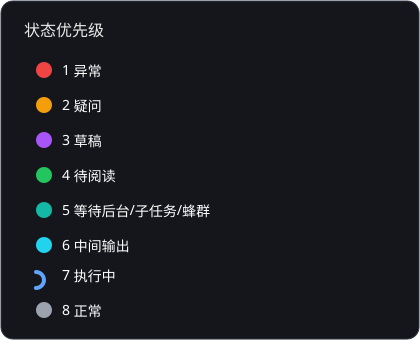

# dsh-dingo 2.4

[English](README.md) | **中文**

> **2.4.1（2026-11-14）可用性修复（适配 DSH 0.2.2 实测）**
>
> - **自动命名恢复**：0.2 已移除 `apiProxy`，按钮 / `/dingo rename` / `rename_current_session`
>   三条入口改为优先走 `sessionController.rename` / `events`，旧 `apiProxy.sessions` 仅作兜底
>   （见 `src/session-api.ts`）；宿主调用统一带 15s 超时，不再永久转圈。
> - **提示音不再丢**：`speaking` 可见窗口下限从 0.8s 提到 4s（客户端 1s 轮询需要足够宽的窗口），
>   并在 `visibilitychange` / `focus` 时立即补查一次（后台标签页定时器会被浏览器节流）。
> - **静音时段结束后真的补播**：之前只有入队时判定，没有唤醒源；现在会按 `quietHours` 结束点
>   定闹钟，到点自动 `requeueDeferred()` + 播报。
> - **系统通知深链端口不再写死 3080**：空配置时取宿主自述地址（`webApp.getAdvertisedUrl()` →
>   `webServer.getOrigin()`），0.2 的随机端口也能点开。
> - **`webServer` 降为软依赖**：无 Web 载体的宿主（headless / SDK）只跳过 `/dingo` RPC，
>   提示音、卡片、命令照常；不再因为缺服务导致整个插件不加载。
> - 清理：删除从未生效的 `channelAuthority` 配置、启动调试日志、无用的 `sameReason` / 空 `if` / `if (true)`；
>   `toneStyle` 现在真的控制"其他对话"的档位（当前对话固定 crisp）；`/dingo status` 的
>   `feedback:` 不再硬编码 enabled；投影缓存标题读取加负缓存，避免每秒对无标题会话重复 `stat`。
> - 新增 26 个测试（`session-api`、`rpc-route`、静音唤醒、seed 卡生命周期、播报窗口）。

> **2.4.0（2026-11-13）适配 DSH 0.2.2**
>
> - **能装进 0.2 了**：宿主 `apiProxy` 在 0.2 已被拆掉，改为 `ctx.get()` 软取；`/dingo` RPC 改用 `webServer` 作用域上下文注册（无 webserver 的宿主静默跳过）；客户端 inject 去掉已删除的 `dsh-client-runtime`，补 `dsh-client-ui-workspace` / `dsh-api-session-controller`。
> - **跨项目**：每 5 秒读一次宿主 `sessionController.list()`（全量、活跃度序、与 GUI 侧栏同源），把别的工作区里在跑的 / 10 分钟内刚结束的会话补进药丸（上限 40 张）。
> - **手机**：视口 ≤ 900px 时药丸从侧栏 footer 切成**右上角固定浮层**（ReactDOM 自建 fixed 容器，不依赖槽位），点开是同一份跨项目卡片列表；点卡片优先走 `uiWorkspace.openSession`，可跨工作区跳转。宽屏/窄屏两个实例互斥挂载，不会重复轮询、重复放提示音。
> - **标题与跳转**：跨工作区的会话标题不在当前客户端 store 里，宿主改从 `~/.dsh/storages/session_projcache/sessions/<id>.json` 的 `record.rows.title.val` 读（带 mtime 缓存）；点击卡片改为**每次现取** `uiWorkspace`（apply 时它常常还没就绪，闭包捕获会永久失效），并同时尝试 `openSession(id)` / `openSession({sessionId})` 两种形状，全失败会打 `[dsh-dingo]` 告警而不是静默。
> - **RPC 自注册**：本版 DSH 的 `connection.rpc.handle` 不可用（其 `owner.webServer` 锚定在 connection 服务自己的 fiber 上，永远解析不到 `webServer`，调用必抛 `cannot get property "webServer" without inject`）。改成插件自己 `ctx.webServer.register({kind:'prefix', path:'/dingo'})` 并按 dsh-client-connection 的线上协议手写信封（见 `src/rpc-route.ts`），客户端 `connection.rpc.call` 一行不改。

2.0 把原来的“事件驱动小卡片”升级为**会话 1:1 常驻卡片**：每个活跃对话一张卡片，实时反映状态，并支持自动命名。

---

## 功能一览

- 会话 1:1 卡片（常驻，状态实时更新）
- 多状态颜色/图标区分
- 紧凑统计胶囊 + 悬浮详细面板
- 全量草稿检测（任意会话，可当待办清单用）
- 等待后台/子任务/蜂群状态识别
- 当前工作区名称标签
- 后台任务数量显示
- 自动命名（按钮 / 对话内自然语言 / 命令）
- 声音提醒 + 系统通知 + 深链直达（1.x 能力保留）

---

## 状态与优先级



| 优先级 | 状态 | 含义 | 颜色 |
|---|---|---|---|
| 1 | 异常 | 任务失败 / 异常结束 | 红 |
| 2 | 疑问 | 需要你回答 | 橙 |
| 3 | 待阅读 | 已完成且需要阅读 | 绿 |
| 4 | 草稿 | 任意会话（非当前）输入框里有未发送内容 | 紫 |
| 5 | 等待后台/子任务/蜂群 | 主对话完成，但后台/子任务/蜂群仍在跑 | 青 |
| 6 | 中间输出 | 执行中且已有部分内容 | 浅蓝 |
| 7 | 执行中 | 正在执行 | 蓝 spinner |
| 8 | 正常 | 已完成且已看过 | 灰 |

> 当前对话正在输入内容属于正常状态，不触发顶部草稿提醒；切到其它对话后原对话草稿会恢复紫色提醒。
>
> 当前对话的「执行中 / 中间输出」**照实计入**统计（spinner 会 +1，"正在跑"是事实不是提醒）；
> 只有「异常 / 疑问 / 草稿 / 待阅读 / 等待后台」这些提醒类状态对当前对话不生效——你正看着它。
>
> **任何会话**只要输入框里还有没发出去的内容，就算「草稿」（紫），不需要你曾经打开过它。
> 草稿强于"已读/执行中"，弱于"待阅读/疑问/异常"。
>
> 草稿读的是宿主自己的持久化（`localStorage['dsh.conversation.<sessionId>']`），所以跨标签页可见、
> 刷新页面仍在；但 DSH 每次启动的 Web 端口会变（等于换了 origin），重启后 DSH 自己也不保留草稿，
> 这里同样读不到。
>
> **当成待办清单用**：暂时不做的会话，随便在输入框里留几个字（例如"TODO 继续"），它就一直是紫色草稿
> 挂在面板里；草稿卡会把这几行字直接显示出来（`✎ TODO 继续`），等别的事做完，从面板里点进去接着干。
>
- **手机上可以直接拖动胶囊**：按住药丸拖到任意位置（松手即落位），位置存在 localStorage、刷新后仍在；
  面板会跟着落点翻方向（左半边左对齐、下半屏向上弹），不会跑出屏幕。
  默认位置在右侧、与对话头部的「对话 / 轨迹」tab 同一行（`PILL_DEFAULT_TOP`，想上下挪改这个常量）。
- 手机上的浮动胶囊是插件自己挂的 ReactDOM 实例，拿不到侧栏槽位的 `useSessions`；宿主因此额外提供
> `/dingo.sessions`（`sessionController.list()` 的紧凑清单，5s 一份、上限 200 条），浮层靠它补会话、
> 补标题，所以手机面板同样能看到纯草稿会话。

---

## 卡片怎么用

> 位置说明：DSH 是三栏布局——**左侧边栏**（工作区/会话列表、设置）｜**中间会话列**｜**右侧详情列**。
> 统计胶囊（全宽条）位于**左侧边栏的底部**，是 footer 区最上面的一行独立横条：在**底部功能按钮**（如 Cordis 面板图标）的**上方**、**设置按钮**（齿轮）的**上方**。

- 左侧边栏底部会看到一条**独立全宽横条**（统计胶囊）：**独占一行**，位于底部功能按钮（Cordis 面板等，换行排在它下面）与设置按钮之上；显示当前活跃会话的状态统计——
  - 异常红点+数量 / 疑问橙点+数量 / 执行中 spinner+数量 / 中间输出 / 等待后台 / 正常计数（图标紧贴数字，单元间留空隙）；
  - 有需要处理的状态时整条呼吸/辉光闪烁（异常最快最猛）；
  - 右侧显示「N 个活跃会话」。
  - **空态补位**：没有任何活跃会话（如刚重启、事件还没产生）时横条常显，显示灰点 + `0`，点开面板显示「暂无活跃会话」——不会凭空消失。
  - **加载即显示**：无需等新事件——执行中 / 待你回答 / 已完成未读 / 草稿 / 后台任务等状态由客户端从会话快照直接判定，host 事件到达后自动合并去重。
  - 会话头部操作行保留：工作区名称标签、`Rename` 按钮（自动命名）。
- **鼠标一进入统计胶囊就立即展开**详细卡片面板（面板从横条向上弹出，没有悬停延迟）：
  - 第一行：工作区名（如有未完成后台任务，会显示小 spinner + 数量）；
  - 第二行：对话名；
  - 不同状态不同颜色；
  - 点击卡片直达对应对话；
  - × 关闭仅移除本次卡片；
  - 面板右上角有图钉按钮：空心灰 = 未锁定，实心橙 = 已锁定。
- **关闭节奏**（未锁定时）：
  - 鼠标离开胶囊/面板约 2s 后收起（给手滑留缓冲）；
  - 面板里连续 5s 没有任何动作（不移动、不点击）自动收起；
  - **点面板外的任何地方立刻收起**——点侧栏的账号 / 设置时不会再被卡片面板挡住；
  - 点卡片跳转到对应对话后收起。
- **锁定**：点面板右上角「锁定」后不再自动收起（移开、空闲、点外面都不收），方便连着点几个会话来回切；
  再点一次「取消锁定」或点统计胶囊即恢复自动收起。
- 横条常驻侧边栏底部，**新开 DSH / 空白首页（hero）时同样可见**；侧边栏收起为 56px rail 时压成紧凑小图标；
- 子代理 / Worker 会话不会出现在卡片清单里。


---

## 自动命名

| 入口 | 方式 |
|---|---|
| `Rename` 按钮 | 独立调用 DeepSeek V4 Flash 生成标题 |
| 对话内自然语言 | 主 LLM 在当前上下文生成标题后调用 `rename_current_session` 工具改名 |
| `/dingo rename` | 兜底命令，走独立 Flash 逻辑 |

生成规则：

- 只取最近 5 条用户消息；
- 中文 6~20 字 / 英文 3~12 词；
- 标题要有区分度，避免“帮我/优化/请问”等雷同前缀；
- 只输出标题本身。

---

## 与 TaskSwarm（蜂群）配合

dsh-dingo 可以和 [dsh-taskswarm](https://github.com/february2015/dsh-taskswarm) 配合：

- TaskSwarm 通过标准 Cordis 服务暴露 `ctx.get('taskswarm')`；
- dsh-dingo 会读取其中的活跃批次；
- 如果某个主对话发起的蜂群还在跑，即使主对话已经完成，卡片也会显示**等待后台/子任务/蜂群**状态；
- 这样你在卡片面板里就能看到“主对话已完成，但蜂群还在跑”的未完成状态。

两个插件可以独立使用，也可以组合使用。

---

## 命令

```
/dingo on|off        # 开/关提醒
/dingo status        # 查看开关、DND、队列状态
/dingo dnd [on|off]  # 免打扰
/dingo rename        # 自动命名当前对话（兜底）
```

---

## 安装

```bash
# 本地源码安装（开发）
dsh plugin --profile web add /path/to/dsh-dingo

# 或 npm 安装（发布后）
dsh plugin --profile web add dsh-dingo
```

DSH profile 通过 `link:/path/to/dsh-dingo` 指向本仓库时，重启 DSH 后生效。

---

## 配置

```yaml
- id: dsh-dingo
  config:
    enabled: true
    feedback:
      toneStyle: soft          # 其他对话的提示音档位（当前对话固定 crisp）
      dnd: false
      dedupeWindowMs: 10000
      quietHours: { start: '', end: '' }   # 静音时段，结束后自动补播
    # systemNotify: true
    # systemNotifyBaseUrl: ''  # 留空 = 自动取宿主地址（0.2 的端口是随机的）
```

> `/dingo on|off` 只影响运行时（重启回默认），目前不写 settings；`off` 时统计胶囊也一起隐藏。

---

## 开发

```bash
npm install
npm run typecheck
npm test
npm run verify
```

更多实现细节见 [docs/v2-features.md](docs/v2-features.md) 和 [docs/dsh-plugin-dev-tips.md](docs/dsh-plugin-dev-tips.md)。

## License

MIT
